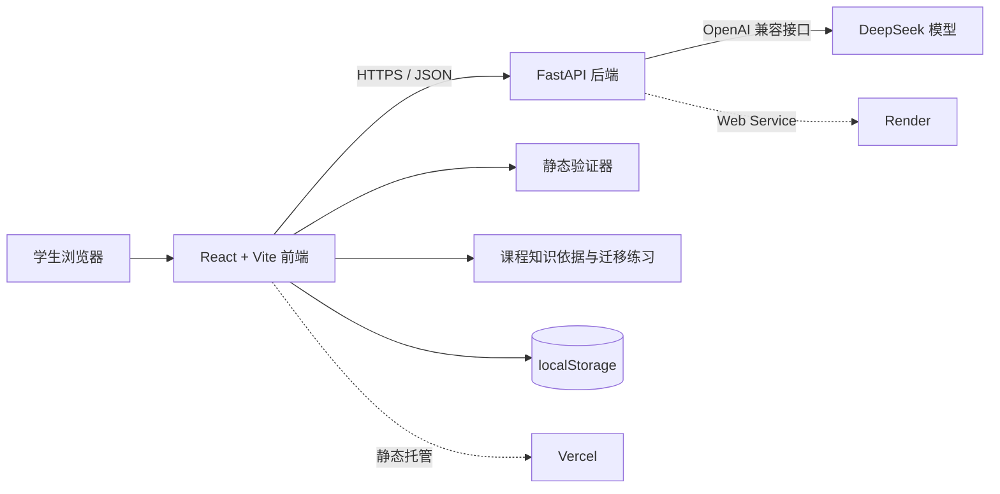
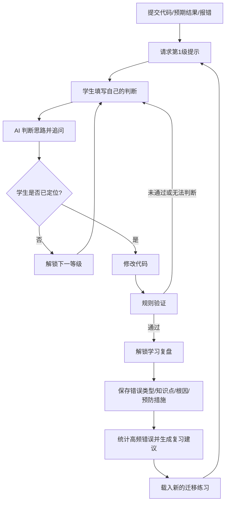

# BugMentor 技术报告

- 参赛命题：中兴赛道命题二——专业课助教智能体
- 负责人：左伟博
- 学校：南京理工大学
- 文档版本：1.1（2026-09-05）

## 1. 摘要

BugMentor 是面向 Python 初学者的 AI 调试学习助手。它不在用户第一次求助时直接给出修改后的代码，而是通过“观察报错—定位范围—理解知识点—形成方案—查看完整答案”的五级提示，引导学生形成可迁移的调试方法。

系统围绕中兴命题要求构建“追问—纠错—再讲解”闭环：学生提交代码和报错，AI 给出当前级别提示；学生必须先提交自己的判断并获得反馈，才能解锁下一等级；修改代码后由确定性规则进行验证；验证成功才解锁学习复盘，代码再次变化会使旧验证结论失效。第三级后系统提供可核验的课程知识依据；保存复盘后，再按历史高频错误生成复习建议与迁移练习。

BugMentor 采用 React、FastAPI 与 DeepSeek 构建在线 Web 应用，并使用可测试的前端规则控制提示解锁、修改验证、知识依据和复习建议。当前支持 IndexError、TypeError 和特定 SyntaxError 的确定性静态验证，前端 35 项、后端 12 项自动化测试均已通过。应用已部署到 Vercel 与 Render，可提供复现证据。系统不在服务器执行用户代码，学习记录默认保存在浏览器本地，并明确验证范围、模型风险与隐私边界。

## 2. 问题理解与业务场景

- 目标用户：正在学习 Python、能编写简单程序但缺乏独立调试能力的大学生和编程初学者。
- 课堂场景：教师布置编程练习后，学生用 BugMentor 自主定位错误。
- 课后场景：学生将错误原因和避免方法保存为学习记录，用于复习。
- 助教场景：重复性的基础报错由系统先行分级引导，助教集中处理更复杂问题。

核心痛点包括：通用 AI 容易直接给出成品答案，学生缺少表达判断与验证猜想的机会；一次修复结束后缺少结构化复盘；助教需要重复回答基础错误。系统输入为 Python 代码、预期结果、报错信息和学生判断，输出为受等级约束的提示、判断反馈、静态验证结果、知识依据及学习复盘。应用价值是把“观察—假设—验证—复盘”固化为可重复的学习流程。

## 3. 总体技术路线

1. 使用 DeepSeek 生成分级提示和对学生判断的反馈，系统提示词约束前四级不能泄露完整答案。
2. 使用独立状态机控制每级解锁条件，保证学生必须先提交非空判断并收到反馈。
3. 使用确定性静态规则验证三类典型错误的修改结果；无法可靠判断时返回“不确定”，不伪造运行结论。
4. 使用本地知识元数据提供 Python 官方文档依据，并依据历史错误频次生成复习计划和迁移练习。
5. 使用 localStorage 保存当前会话和最近 20 条复盘；后端只承担请求校验、AI 代理、安全头、CORS 与健康检查。
6. 使用自动化测试、GitHub Actions、线上冒烟脚本和视觉证据形成可复现的质量链路。

## 4. 系统架构



系统不执行用户提交的 Python 代码。AI 负责生成分级提示和对学生判断进行反馈；前端静态验证器仅对明确支持的典型错误模式进行确定性检查；课程知识依据、复习计划与迁移练习由可测试的本地规则生成；当前会话和复盘记录保存在浏览器本地。

### 4.1 模块职责

| 模块 | 主要文件 | 责任 |
|---|---|---|
| 页面与交互 | `frontend/src/App.jsx` | 表单、五级提示、学生判断、验证、复盘、历史记录 |
| 会话持久化 | `frontend/src/debugSession.js` | 保存、恢复、重置当前调试状态 |
| 提示解锁 | `frontend/src/hintProgress.js` | 只有本级反馈成功后才能进入下一级，第五级答案受控 |
| 规则验证 | `frontend/src/validator.js` | IndexError、TypeError、SyntaxError 修改结果检查 |
| 演示案例 | `frontend/src/demoExamples.js` | 三类典型错误的一键载入数据 |
| 学习支持 | `frontend/src/learningSupport.js` | 知识依据、历史统计、复习计划、迁移练习和导出结构 |
| API 服务 | `backend/main.py` | 请求校验、CORS、安全头、请求 ID、健康检查 |
| AI 服务 | `backend/ai_service.py` | DeepSeek 客户端、系统提示词、分级保密规则 |

## 5. 核心算法与关键模块

### 5.1 核心业务流程



### 5.2 五级提示约束

1. 第一级只引导观察报错或实际结果，不指出具体答案。
2. 第二级缩小检查范围，不给替换值或完整代码。
3. 第三级讲解相关概念，引导学生自行计算或判断。
4. 第四级给出接近解决方案的修改思路，仍不提供完整程序。
5. 第五级才完整解释原因、修改代码与预防方法。

每一级都要求学生提交非空判断并收到反馈，才能解锁下一等级。刷新后提示等级和反馈状态会从本地会话恢复。

### 5.3 修改后验证

规则验证器不会执行代码，而是比较原始代码与修改后代码：

- IndexError：检查直接列表索引是否仍越界，支持合法正索引和负索引。
- TypeError：检查字符串与变量的直接拼接是否改为 `str()`、f-string 或逗号分隔输出。
- SyntaxError：检查 `if`、`for`、`while`、函数定义等复合语句缺少冒号的场景。

无法可靠判断时系统返回“暂时无法判断”，不会把删除代码或大幅改写误判为成功。

### 5.4 知识依据与个性化复习

- 第三级开始展示与当前错误匹配的知识依据卡，包括规则、核验方法和 Python 官方文档链接。
- 当前覆盖列表索引、字符串与数据类型、复合语句三个基础知识点。
- 系统只统计本地学习记录中的错误类型，不分析身份信息，也不上传学习历史。
- 系统将出现次数最多的错误作为阶段重点，生成“当天复述—下次迁移练习—本周回看”的三步计划。
- 推荐练习是团队自行设计的预设新案例，可一键载入并重新走完整调试闭环。
- 学习记录可导出为带版本号、导出时间和记录数量的 JSON，便于学生自行保存和复查。

该功能不宣称拥有完整课程知识库，也不根据少量记录推断学习能力；推荐仅用于帮助学生安排下一次练习。

### 5.5 API 设计

#### `GET /`

返回服务运行信息。

#### `GET /health`

供部署平台和验收脚本检查服务健康状态。

#### `POST /api/debug`

请求字段：

- `code`：Python 代码，1—10000 字符。
- `expected_result`：预期结果，最多 2000 字符。
- `error_message`：报错信息，最多 5000 字符。
- `hint_level`：1—5。
- `student_response`：学生判断，最多 2000 字符。
- `previous_hint`：上一条提示，最多 2000 字符。

响应包含提示等级、提示正文、交互类型和模型模式。AI 异常时返回不暴露内部细节的 503 错误。

## 6. 数据与预处理

项目不采集训练数据，也不抓取课程平台、题库或学生身份信息。演示代码和迁移练习由参赛者自行编写；知识依据只保存 Python 官方文档链接、规则摘要和核验方式。提交给模型的文本在前后端接受类型、长度和提示等级校验；服务端日志只保留请求 ID、路径、状态码、耗时与异常类型，不记录代码正文。

当前会话和学习记录在浏览器中保存。读取旧数据时进行字段类型与版本兼容校验，损坏数据会安全降级；历史记录最多保留 20 条，支持单条删除、全部清空和 JSON 导出。项目没有账号系统、数据库或跨设备画像。

### 6.1 安全与权限

- 无账号系统，不收集姓名、手机号或邮箱。
- 用户代码仅在主动请求提示时传往后端和 DeepSeek。
- 后端日志不记录代码、报错全文、完整请求体或密钥。
- DeepSeek 密钥只存在 Render 环境变量中。
- 接口使用 Pydantic 做类型、长度和等级校验。
- 生产环境使用精确 CORS 白名单、安全响应头和 `no-store`。
- 前端不使用 `dangerouslySetInnerHTML`，模型文本由 React 自动转义。
- 前端知识链接只指向 Python 官方文档，打开链接时不附带用户代码或学习记录。
- 前端表单与后端接口均设置输入长度上限；学习记录导出只在浏览器内完成。

详细说明见根目录 `PRIVACY.md` 与 `SECURITY.md`。

## 7. 实验设计与评估指标

评测样本由 25 条正式用例组成，覆盖正常、异常、边界、安全、状态恢复、响应式、知识依据、迁移学习与数据导出。其中 TC-01 对应中兴赛道命题二统一必测场景，使用 IndexError 示例检查步骤化解析、错因诊断、追问纠错和关键结论验证。

主要指标定义如下：

- 自动化测试通过率：通过测试数 / 自动化测试总数，目标 100%。
- 核心闭环完成率：能够完成提交、判断、提示、修改验证和复盘的支持案例数 / 支持案例总数，目标 100%。
- 越级泄露次数：第1—4级出现完整答案的次数，目标 0。
- 误判成功次数：未修改、删除语句或仍错误代码被判为成功的次数，目标 0。
- 接口可用性：线上前端、健康检查和真实 AI 冒烟请求均应返回成功。
- 安全边界：未知来源 CORS 应拒绝，公开响应不得包含密钥、堆栈或用户代码日志。

复现方式包括 `npm test`、后端 `unittest`、GitHub Actions、`scripts/smoke_test.py` 和 `test-cases.md` 中的逐项步骤。

## 8. 测试结果与案例展示

- 前端 35 项自动化测试：验证器、提示锁、会话恢复、演示数据、知识依据、复习计划、迁移练习、导出结构和异常数据降级等。
- 后端 12 项自动化测试：正常响应、AI 异常、字段边界、健康检查、安全头、请求 ID 和 CORS。
- GitHub Actions 在每次推送和拉取请求时自动运行测试、Lint、构建、依赖检查。
- 线上验收脚本检查前后端状态、健康接口、安全头和 CORS。

自动化测试通过率为 47/47（100%）；生产构建、Lint 和依赖检查通过。IndexError 案例中，`numbers[3]` 不修改、只改注释或删除访问语句均不会通过，改为 `numbers[2]` 或 `numbers[-1]` 可通过。TypeError 案例支持 `str()`、f-string 和逗号分隔输出；SyntaxError 案例要求补回原复合语句的冒号，删除语句不会被误判成功。

线上验收确认前端与健康接口 HTTP 200、真实 DeepSeek 请求返回非空一级提示、合法来源 CORS 通过、未知来源被拒绝。桌面端与 500 px 窄屏首屏均已保存视觉证据。完整结果见 `final-package/acceptance-report.md`。

正式测试用例见 `test-cases.md`。

## 9. 部署与配置

### 线上地址

- 前端：https://ai-app-challenge-2026.vercel.app/
- 后端：https://bugmentor-api.onrender.com
- API 文档：https://bugmentor-api.onrender.com/docs

### 环境变量

后端：

```env
DEEPSEEK_API_KEY=服务端密钥
DEEPSEEK_BASE_URL=https://api.deepseek.com
DEEPSEEK_MODEL=deepseek-v4-flash
FRONTEND_ORIGINS=https://ai-app-challenge-2026.vercel.app
```

前端：

```env
VITE_API_BASE_URL=https://bugmentor-api.onrender.com
```

依赖和本地运行步骤见根目录 `README.md`，部署、排障和回滚步骤见 `DEPLOYMENT.md`。

## 10. 已知限制与后续计划

- 当前只对三类典型错误提供确定性验证，其余错误仍依赖提示后人工判断。
- 用户代码不会在沙箱中真实执行，因此系统不会声称已经运行代码。
- 学习记录保存在单一浏览器，尚未提供账号与跨设备同步。
- 个性化复习仅按错误类型频次进行本地规则推荐，不等同于完整的学生能力画像。
- 当前知识依据覆盖三个演示知识点，不是完整课程知识库。
- Render 免费实例可能休眠，演示前需提前访问健康检查唤醒服务。
